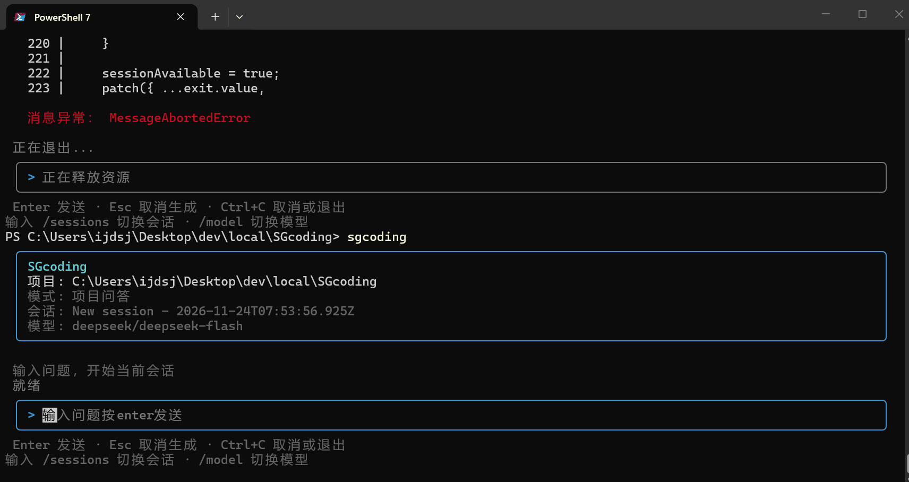
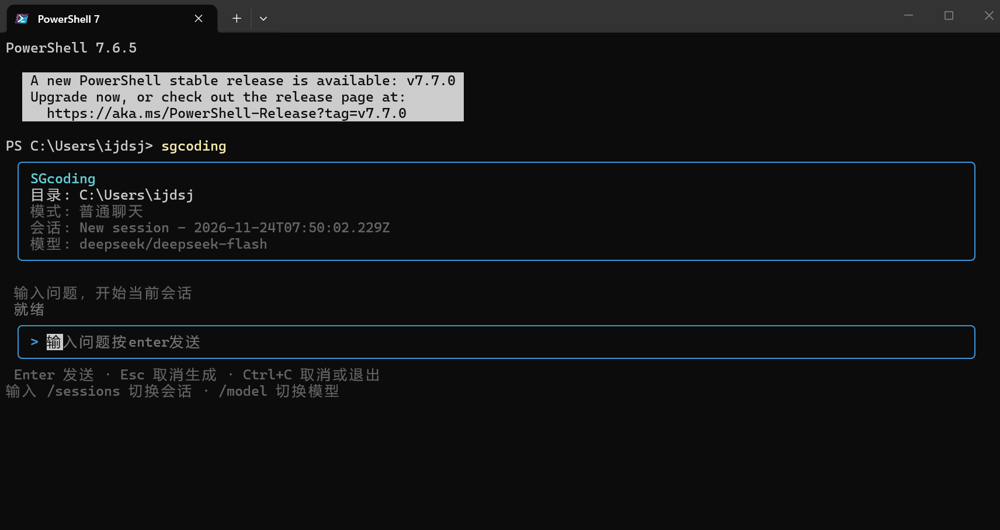
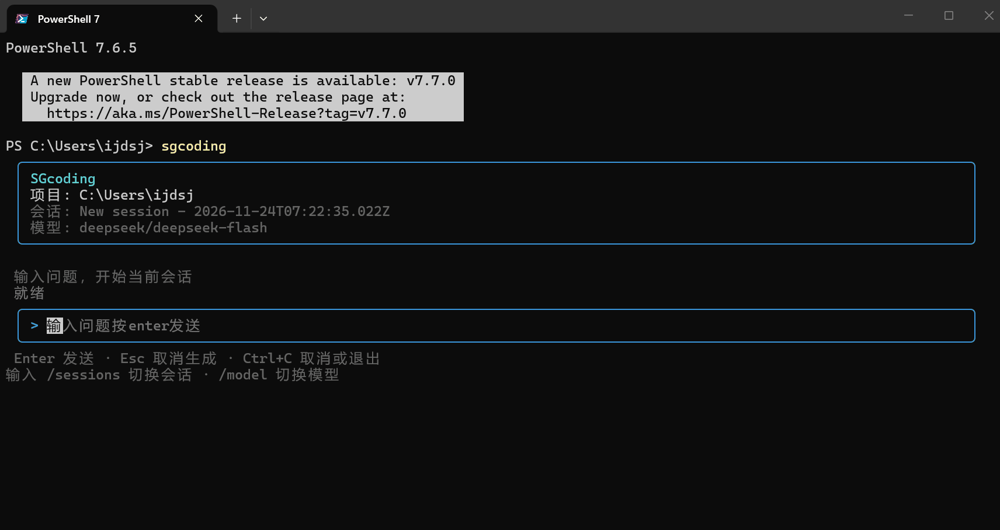

# SGcoding

基于 TypeScript、Node.js、Effect、AI SDK 和 Ink 构建的终端 AI 助手，参考 OpenCode 的服务分层与消息处理流程。支持普通聊天、模型切换、会话管理和带源码引用的 RAG 问答。

## 安装

需要 Node.js 22+、npm 和交互式终端；项目检索需要 Git。

从源码安装，在项目根目录执行：

```powershell
npm install
npm run build
npm link
```

也可以安装编译好的分发包，无需自行构建：

```powershell
npm install --global .\sgcoding-0.0.3.tgz
```

## 配置与启动

首次运行 `sgcoding` 会在 `~/.sgcoding` 中生成默认配置。API Key 的配置方式保持不变，在 `~/.sgcoding/.env` 中填写所用默认平台的 Key：

```dotenv
DEEPSEEK_API_KEY=你的_DeepSeek_API_Key
# ARK_API_KEY=你的_Ark_API_Key
```

保存后重新启动：

```powershell
sgcoding
```

默认启动模型为 `deepseek/deepseek-flash`，用 `/model` 切换。以下默认模型保留：

| 默认模型引用 | Key 环境变量 |
|---|---|
| `deepseek/deepseek-flash` | `DEEPSEEK_API_KEY` |
| `deepseek/deepseek-v4-pro` | `DEEPSEEK_API_KEY` |
| `ark/doubao-seed-2-0-mini-260428` | `ARK_API_KEY` |

## 添加自定义模型

可以编辑用户目录的 `~/.sgcoding/provider.yaml`，在已有平台的 `models` 下追加模型，或添加新平台。建议保留默认条目，在文件末尾追加，例如：

```yaml
my-provider:
  name: 自定义平台
  env: [MY_MODEL_API_KEY]
  options:
    baseURL: https://example.com/v1
  models:
    your-model-id:
      name: 自定义模型
```

将示例地址和模型 ID 替换为平台实际提供的值，目前要求支持 Responses API。`env` 指定读取哪个环境变量，`name` 是显示名称；API Key 仍填写在 `~/.sgcoding/.env` 中：

```dotenv
MY_MODEL_API_KEY=你的_API_Key
```

修改后重启，用 `/model` 选择 `my-provider/your-model-id`。Windows 配置路径通常是 `C:\Users\用户名\.sgcoding\provider.yaml`。可删除默认模型配置
## 使用

```powershell
sgcoding
```

- 在普通目录启动即可聊天，用户主目录默认也是普通聊天模式。
- 在独立 Git 工作区或其子目录启动，自动启用项目问答；普通聊天仍直接回答。
- 项目问答提供 `search_project` 和 `read`，目前不提供文件写入或 shell 执行。

配置和数据跨工作区共用，默认放在：

```text
~/.sgcoding/
├─ provider.yaml    模型与接口地址
├─ .env             API Key
├─ sgcoding.db      会话与消息数据库
└─ cache/           按工作区隔离的 RAG 索引
```

## RAG 源码问答

在目标 Git 工作区启动后，可以提问：

```text
请用 search_project 搜索 switchSession，解释它怎样切换会话，并引用源码路径和行号。
```

RAG 使用本地 SQLite FTS5/BM25 检索 `.ts`、`.tsx`、`.md` 文件，每次最多返回 5 个片段。首次检索自动建索引，后续检索刷新变更和删除的文件；模型可继续用 `read` 核对上下文，再生成带路径和行号引用的回答。

## 演示

### RAG 源码问答



### 切换模型



### 切换会话



## 开发与打包

```powershell
npm run dev       # 直接运行源码
npm run typecheck # 类型检查
npm run build     # 构建
npm run rag:eval  # 固定版本的检索评测
```
